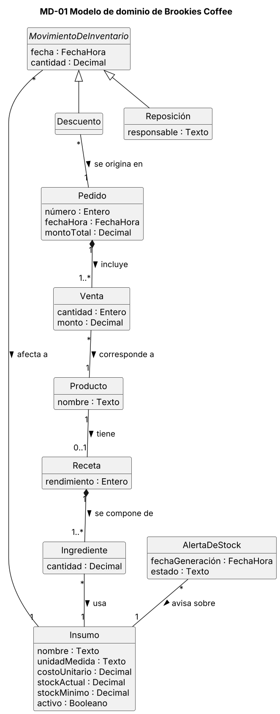

# Modelo de dominio

## Diagrama

Archivo fuente: [`./diagramas/modelo-dominio.puml`](./diagramas/modelo-dominio.puml)

## Descripción de las clases

| Clase | Qué representa en el negocio | Atributos |
|-------|------------------------------|-----------|
| Insumo | Un ingrediente que se usa para preparar productos (café, leche, harina, etc.), con su stock, su nivel mínimo y su costo unitario en pesos chilenos (CLP, entero). | nombre, unidadMedida, costoUnitario, stockActual, stockMinimo, activo |
| Producto | Una bebida o galleta que Brookies Coffee vende (Café Latte, Lemon Empire, etc.). | nombre |
| Receta | La composición de un producto: qué insumos y en qué cantidad lleva. | rendimiento |
| Ingrediente | La cantidad de un insumo específico que una receta necesita (una línea de la receta). | cantidad |
| Pedido | Un pedido confirmado que llega desde el sistema de toma de pedidos, con sus productos y el monto a cobrar. | número, fechaHora, montoTotal |
| Venta | La venta de un producto dentro de un pedido: cuántas unidades, por cuánto monto, si se descontaron sus insumos y en qué estado está (ciclo de vida en EST-03). | cantidad, monto, sinReceta, estado |
| MovimientoDeInventario *(abstracta)* | Un cambio en el stock de un insumo. Da la trazabilidad entre ventas y consumo que pide RP-08. | fecha, cantidad |
| Descuento | Movimiento que resta stock porque una venta consumió insumos según la receta. Se registra cuando la venta queda Confirmada. | — |
| Reposición | Movimiento que suma stock porque el administrador registró la compra de un insumo. | responsable |
| Ajuste | Movimiento que corrige el stock por una merma (resta) o por una corrección de conteo (suma o resta la diferencia con lo contado). Su cantidad lleva signo. | motivo, responsable |
| AlertaDeStock | El aviso de que un insumo llegó o bajó de su nivel mínimo. Se conserva aunque se resuelva (ciclo de vida en EST-02). | fechaGeneración, estado |

## Asociaciones

| Asociación | Clases | Multiplicidades | Justificación |
|------------|--------|-----------------|----------------|
| tiene | Producto – Receta | 1 a 0..1 | Un producto puede no tener receta definida todavía; en ese caso el pedido que lo incluye no descuenta insumos (HU-01, CA5). |
| se compone de *(composición)* | Receta – Ingrediente | 1 a 1..\* | Una receta necesita al menos un insumo; un ingrediente no existe fuera de su receta (HU-06, CA2). |
| usa | Ingrediente – Insumo | \* a 1 | Cada línea de la receta corresponde a un único insumo, pero un mismo insumo aparece en varias recetas (base común de las masas, por ejemplo). |
| incluye *(composición)* | Pedido – Venta | 1 a 1..\* | Un pedido confirmado siempre trae al menos un producto vendido; la venta no existe fuera de su pedido (RP-01). |
| corresponde a | Venta – Producto | \* a 1 | Cada venta es de un único producto, y un producto aparece en muchas ventas. |
| afecta a | MovimientoDeInventario – Insumo | \* a 1 | Cada movimiento cambia el stock de un único insumo, y un insumo acumula un movimiento por cada descuento, reposición o ajuste (RP-08). |
| se origina en | Descuento – Venta | \* a 1 | Una venta genera un descuento por cada insumo de su receta cuando se confirma; un descuento siempre viene de una venta (y, a través de ella, de su pedido). Una venta pendiente de insumos o cancelada no tiene descuentos. |
| avisa sobre | AlertaDeStock – Insumo | \* a 1 | Un insumo puede acumular varias alertas a lo largo del tiempo (una por cada vez que llega al mínimo); cada alerta es de un único insumo. |
| *(generalización)* | MovimientoDeInventario ← Descuento, Reposición, Ajuste | — | Son movimientos de stock con los mismos atributos base, pero el descuento nace de una venta confirmada, y la reposición y el ajuste llevan un responsable; el ajuste además lleva su motivo (RP-08, RP-14). |

## Decisiones de modelado

- **El administrador, el barista y el personal de caja no se modelaron como clases.** Son roles de las personas, no conceptos del negocio: el acceso exclusivo del administrador es una política (RP-09), y quién registró una reposición queda como el atributo `responsable` de `Reposición`.
- **"Sistema de toma de pedidos" no se modela como clase del dominio**, porque es un sistema externo (de otro equipo), no un concepto del negocio de Brookies Coffee. Aparece como actor en los casos de uso y como participante externo en los diagramas de secuencia.
- **Composición** entre Receta e Ingrediente y entre Pedido y Venta, porque la parte no existe sin el todo. Entre Producto y Receta se usó una asociación simple: un producto puede existir sin receta (HU-01, CA5).
- **Herencia** solo en `MovimientoDeInventario` (con `Descuento`, `Reposición` y `Ajuste`), porque son los tres tipos de movimiento que piden RP-08 y RP-14 y se diferencian en su origen (pedido, compra o corrección del administrador).
- **`AlertaDeStock` es una clase propia y no un atributo de `Insumo`**, porque una misma alerta tiene fecha y ciclo de vida (vigente o resuelta) y un insumo puede tener varias a lo largo del tiempo.
- **Las recetas no se versionan.** Cuando una receta cambia, el cambio vale para los pedidos siguientes y los descuentos ya registrados no se modifican (HU-06, CA4), porque cada `Descuento` guarda su propia cantidad.
- **Solo se elimina un insumo sin historia.** Un insumo que está en una receta o que ya tiene movimientos de inventario solo se puede desactivar, para no perder la trazabilidad de RP-08. Si un insumo sin movimientos se elimina, sus alertas se eliminan con él.
- **`estado` de `Venta` (cambio de requerimientos, Evaluación 2).** Una venta cuya receta necesita más insumos de los que hay en stock queda «Pendiente de confirmación» y no descuenta nada; el administrador después la confirma (si ya llegaron los insumos) o la cancela. Por eso `Venta` tiene ciclo de vida propio (EST-03) con los estados «Confirmada», «Pendiente de confirmación» y «Cancelada». Se agregó como atributo y no como clase nueva, porque es la misma venta que cambia de situación. Los `Descuento` de una venta pendiente se registran recién cuando se confirma, y quedan asociados a esa `Venta`.

- **Cómo se resuelven las ventas pendientes de insumos (cambio de requerimientos, Evaluación 2).** No se agregó ninguna clase nueva: resolver una venta pendiente es cambiar el `estado` de la misma `Venta`. Ver las ventas pendientes es consultar las `Venta` con estado «Pendiente de confirmación» (los insumos que faltan se calculan comparando la `Receta` del producto con el `stockActual` de cada `Insumo`, por eso no se guardan). Confirmar una venta pasa su estado a «Confirmada» y recién ahí crea sus `Descuento`; cancelarla pasa su estado a «Cancelada» y no crea ninguno. Se eligió esto y no una clase aparte (por ejemplo `VentaPendiente`) porque es la misma venta en otra situación, y no una cosa distinta del negocio.
- **`Descuento` se asocia a `Venta` y no a `Pedido` (cambio de requerimientos, Evaluación 2).** Un pedido puede traer varios productos y solo algunas de sus ventas pueden quedar pendientes; el descuento de una venta que se confirma después tiene que apuntar a esa venta y no al pedido completo. El pedido sigue siendo alcanzable desde el descuento a través de su venta (RP-08).

