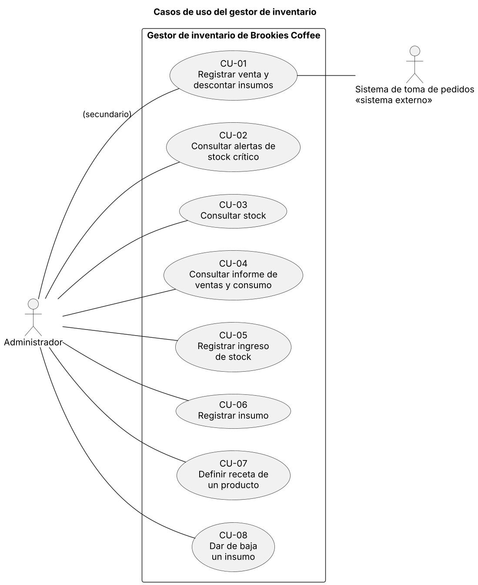

# Casos de uso

## Actores

| Actor | Tipo (humano / sistema externo) | Descripción |
|-------|----------------------------------|-------------|
| Administrador | Humano | El dueño de Brookies Coffee (o quien tenga ese rol). Revisa el stock y las alertas, registra reposiciones, insumos y recetas, y consulta informes (RP-09: es el único rol con acceso al sistema). |
| Sistema de toma de pedidos | Sistema externo | El sistema del otro equipo que toma el pedido del cliente y lo envía ya confirmado, con sus productos, cantidades y el monto de la venta (ver [02-rediseno-to-be.md](./02-rediseno-to-be.md), evento "Pedido confirmado"). El gestor de inventario no participa en tomar el pedido. |

## Diagrama de casos de uso

Archivo fuente: [`./diagramas/casos-de-uso.puml`](./diagramas/casos-de-uso.puml)

## Casos de uso y su origen

| ID | Caso de uso (objetivo del actor) | Actor principal | Historia de origen |
|----|-----------------------------------|-----------------|---------------------|
| CU-01 | Registrar venta y descontar insumos | Sistema de toma de pedidos *(el Administrador participa como actor secundario: recibe el aviso de producto sin receta)* | [HU-01](./04-historias-usuario.md#hu-01--registrar-venta) |
| CU-02 | Consultar alertas de stock crítico | Administrador | [HU-02](./04-historias-usuario.md#hu-02--alertar-stock-crítico) |
| CU-03 | Consultar stock | Administrador | [HU-03](./04-historias-usuario.md#hu-03--consultar-stock) |
| CU-04 | Consultar informe de ventas y consumo | Administrador | [HU-04](./04-historias-usuario.md#hu-04--consultar-informe) |
| CU-05 | Registrar ingreso de stock | Administrador | [HU-05](./04-historias-usuario.md#hu-05--registrar-ingreso-de-stock) |
| CU-06 | Registrar insumo | Administrador | [HU-06](./04-historias-usuario.md#hu-06--registrar-insumos-y-recetas) |
| CU-07 | Definir receta de un producto | Administrador | [HU-06](./04-historias-usuario.md#hu-06--registrar-insumos-y-recetas) |
| CU-08 | Dar de baja un insumo (eliminarlo o desactivarlo) | Administrador | [HU-06](./04-historias-usuario.md#hu-06--registrar-insumos-y-recetas) (CA3) |

## Notas sobre include/extend

- **No se usó `include` ni `extend`.** Ningún caso de uso comparte un fragmento de comportamiento reutilizable con otro (`include`), y ninguno es un comportamiento opcional que se enganche a otro caso de uso como objetivo propio de un actor (`extend`).
- **La alerta de stock crítico no es un caso de uso aparte.** La genera el propio sistema al procesar un pedido (parte de CU-01, ver DSS-02); lo que el administrador hace con ella es consultarla (CU-02). Lo mismo con el aviso de "producto sin receta": es un resultado de CU-01 (HU-01, CA5), no un objetivo de un actor.
- HU-06 agrupa tres objetivos distintos del administrador (registrar insumos, definir recetas y dar de baja insumos), por eso origina CU-06, CU-07 y CU-08.
- RP-06 menciona "editar" insumos; en esta entrega la edición no se especifica como caso de uso aparte.
