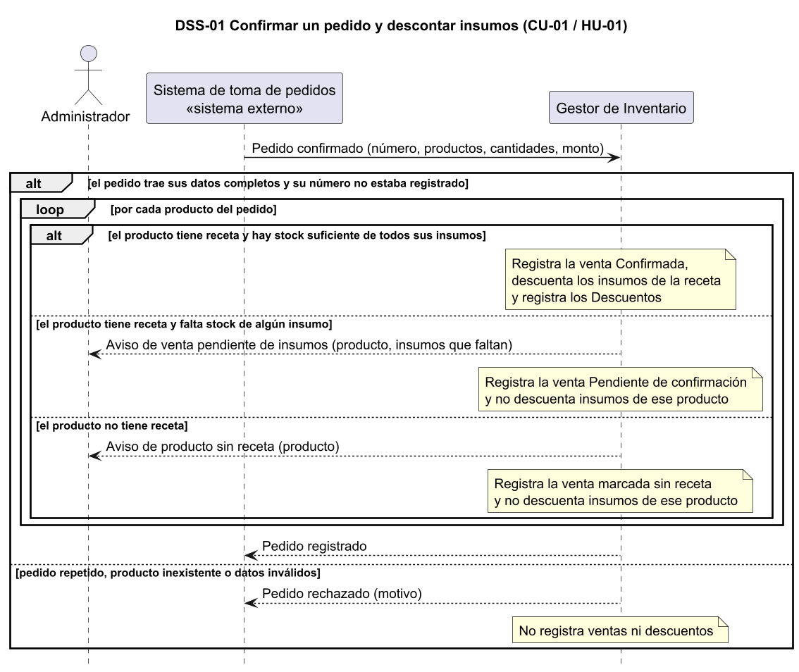
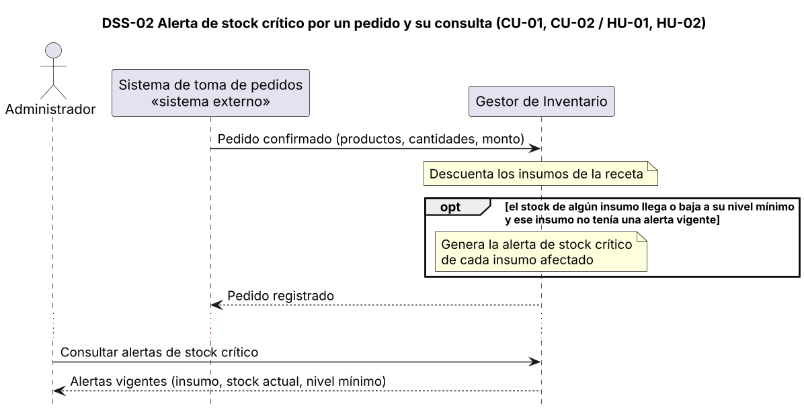
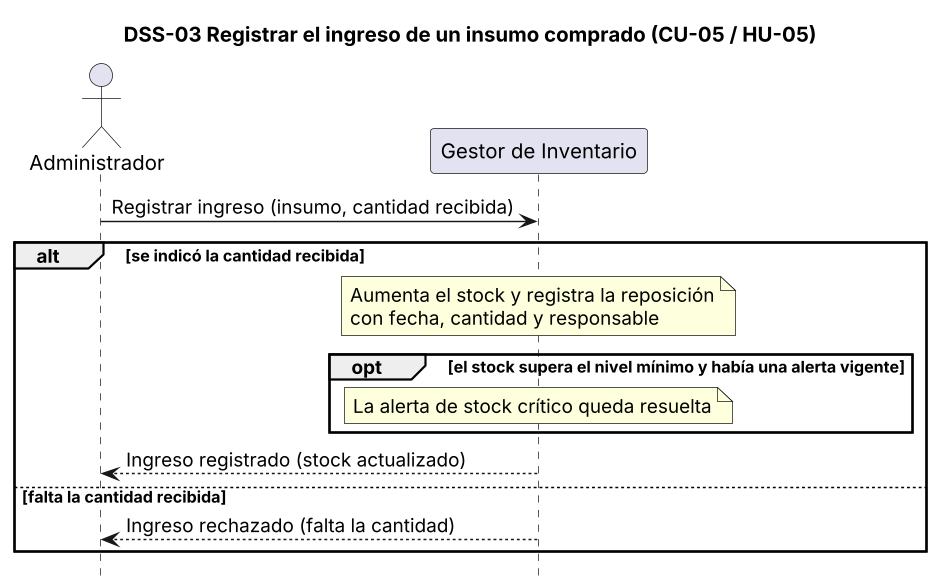
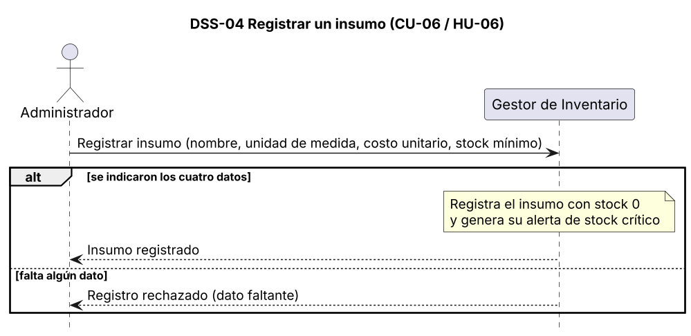
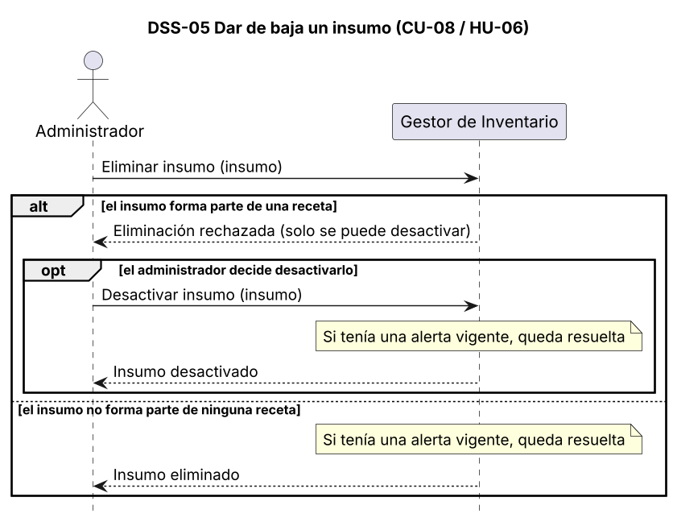

# Diagramas de secuencia de sistema

El gestor de inventario tiene un solo punto real de integración con otro sistema: el **sistema de toma de pedidos** (de otro equipo), que envía el mensaje "Pedido confirmado" (ver [02-rediseno-to-be.md](./02-rediseno-to-be.md)). Por eso DSS-01 y DSS-02 son los diagramas con integración externa; DSS-03, DSS-04 y DSS-05 cubren las acciones del administrador que cambian el stock y los insumos y que alimentan los diagramas de estado. En todos el sistema es una sola caja negra: no se muestran clases internas, solo el "Gestor de Inventario" como un participante, y lo que hace por dentro se anota como nota.

## DSS-01 — Confirmar un pedido y descontar insumos

- Caso de uso: [CU-01](./09-casos-de-uso.md)
- Historia: [HU-01](./04-historias-usuario.md#hu-01--registrar-venta)
- Sistemas externos que participan: Sistema de toma de pedidos

Archivo fuente: [`./diagramas/dss-01.puml`](./diagramas/dss-01.puml)

Variantes representadas:
- **loop** — el gestor revisa cada producto del pedido.
- **alt**, dentro del loop — el producto tiene receta (se descuentan los insumos y se registra la venta) o no la tiene (se avisa al administrador y no se descuentan insumos, HU-01 CA5).

## DSS-02 — Alerta de stock crítico por un pedido y su consulta

- Casos de uso: [CU-01](./09-casos-de-uso.md) y [CU-02](./09-casos-de-uso.md)
- Historias: [HU-01](./04-historias-usuario.md#hu-01--registrar-venta) y [HU-02](./04-historias-usuario.md#hu-02--alertar-stock-crítico)
- Sistemas externos que participan: Sistema de toma de pedidos

Archivo fuente: [`./diagramas/dss-02.puml`](./diagramas/dss-02.puml)

Variantes representadas:
- **opt** — la alerta se genera solo si el stock de algún insumo llega o baja a su nivel mínimo y ese insumo no tenía ya una alerta vigente.
- La segunda parte del diagrama (después de la línea punteada) muestra al administrador consultando más tarde las alertas vigentes (CU-02).

## DSS-03 — Registrar el ingreso de un insumo comprado

- Caso de uso: [CU-05](./09-casos-de-uso.md)
- Historia: [HU-05](./04-historias-usuario.md#hu-05--registrar-ingreso-de-stock)
- Sistemas externos que participan: ninguno (solo interactúa el Administrador)

Archivo fuente: [`./diagramas/dss-03.puml`](./diagramas/dss-03.puml)

Variantes representadas:
- **alt** — el ingreso se registra (se indicó la cantidad recibida) o se rechaza porque falta la cantidad (HU-05, CA1).
- **opt**, dentro del caso principal — la alerta de stock crítico se resuelve si el stock supera el nivel mínimo y había una alerta vigente (HU-05, CA4).

## DSS-04 — Registrar un insumo

- Caso de uso: [CU-06](./09-casos-de-uso.md)
- Historia: [HU-06](./04-historias-usuario.md#hu-06--registrar-insumos-y-recetas)
- Sistemas externos que participan: ninguno (solo interactúa el Administrador)

Archivo fuente: [`./diagramas/dss-04.puml`](./diagramas/dss-04.puml)

Variantes representadas:
- **alt** — el insumo se registra (con stock 0, lo que genera su alerta de stock crítico) o se rechaza porque falta alguno de los cuatro datos (HU-06, CA1).

## DSS-05 — Dar de baja un insumo

- Caso de uso: [CU-08](./09-casos-de-uso.md)
- Historia: [HU-06](./04-historias-usuario.md#hu-06--registrar-insumos-y-recetas) (CA3)
- Sistemas externos que participan: ninguno (solo interactúa el Administrador)

Archivo fuente: [`./diagramas/dss-05.puml`](./diagramas/dss-05.puml)

Variantes representadas:
- **alt** — el insumo no forma parte de ninguna receta y se elimina, o forma parte de una receta y la eliminación se rechaza.
- **opt**, dentro del rechazo — el administrador decide desactivar el insumo en vez de eliminarlo.
