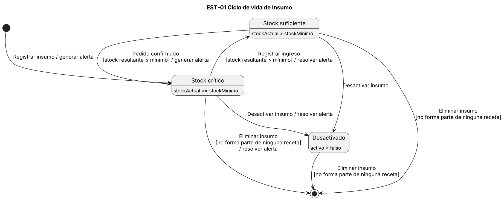

# Diagramas de estado

Los eventos de estos diagramas son los mismos mensajes de los diagramas de secuencia ([10-diagramas-secuencia.md](./10-diagramas-secuencia.md)). Los eventos que no cambian el estado (por ejemplo, un pedido que baja el stock sin cruzar el nivel mínimo) no se dibujan.

## EST-01 — Ciclo de vida de Insumo

- Clase del dominio: [Insumo](./08-modelo-dominio.md)
- Diagramas de secuencia relacionados: [DSS-01](./10-diagramas-secuencia.md), [DSS-02](./10-diagramas-secuencia.md), [DSS-03](./10-diagramas-secuencia.md), [DSS-04](./10-diagramas-secuencia.md), [DSS-05](./10-diagramas-secuencia.md)

Archivo fuente: [`./diagramas/est-01.puml`](./diagramas/est-01.puml)

### Tabla de transiciones

| Estado origen | Evento | Guarda | Acción | Estado destino |
|---------------|--------|--------|--------|----------------|
| (inicial) | Registrar insumo | — | generar alerta | Stock crítico |
| Stock suficiente | Pedido confirmado | stock resultante ≤ mínimo | generar alerta | Stock crítico |
| Stock crítico | Registrar ingreso | stock resultante > mínimo | resolver alerta | Stock suficiente |
| Stock suficiente | Desactivar insumo | — | — | Desactivado |
| Stock crítico | Desactivar insumo | — | resolver alerta | Desactivado |
| Stock suficiente | Eliminar insumo | no forma parte de ninguna receta | — | (final) |
| Stock crítico | Eliminar insumo | no forma parte de ninguna receta | resolver alerta | (final) |
| Desactivado | Eliminar insumo | no forma parte de ninguna receta | — | (final) |

Un insumo recién registrado tiene stock 0, que está bajo cualquier nivel mínimo, por eso nace en "Stock crítico" y con su alerta generada.

## EST-02 — Ciclo de vida de AlertaDeStock

- Clase del dominio: [AlertaDeStock](./08-modelo-dominio.md)
- Diagramas de secuencia relacionados: [DSS-02](./10-diagramas-secuencia.md), [DSS-03](./10-diagramas-secuencia.md), [DSS-04](./10-diagramas-secuencia.md), [DSS-05](./10-diagramas-secuencia.md)

Archivo fuente: [`./diagramas/est-02.puml`](./diagramas/est-02.puml)

### Tabla de transiciones

| Estado origen | Evento | Guarda | Acción | Estado destino |
|---------------|--------|--------|--------|----------------|
| (inicial) | Pedido confirmado, Registrar insumo | stock del insumo ≤ mínimo | generar alerta | Vigente |
| Vigente | Registrar ingreso | stock del insumo > mínimo | resolver alerta | Resuelta |
| Vigente | Desactivar insumo, Eliminar insumo | — | resolver alerta | Resuelta |
| Resuelta | — *(transición de finalización: la alerta resuelta se archiva)* | — | — | (final) |

Mientras la alerta está "Vigente" aparece en la consulta de alertas (CU-02); cuando pasa a "Resuelta" deja de mostrarse (HU-02, CA4).
