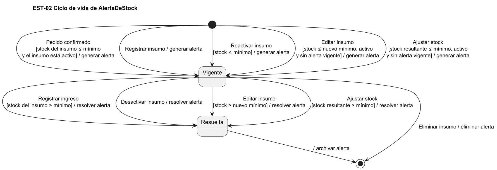
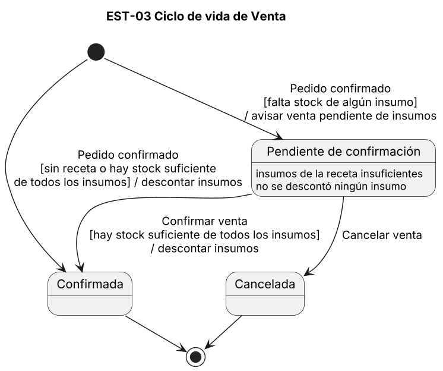

# Diagramas de estado

Los eventos de estos diagramas son los mismos mensajes de los diagramas de secuencia ([10-diagramas-secuencia.md](./10-diagramas-secuencia.md)). Los eventos que no cambian el estado y que el gestor acepta en ese estado se dibujan como transiciones internas dentro del estado. Así, todo evento que el gestor acepta aparece en el diagrama, y un evento que no está modelado en un estado se rechaza.

## EST-01 — Ciclo de vida de Insumo

- Clase del dominio: [Insumo](./08-modelo-dominio.md)
- Diagramas de secuencia relacionados: [DSS-01](./10-diagramas-secuencia.md), [DSS-02](./10-diagramas-secuencia.md), [DSS-03](./10-diagramas-secuencia.md), [DSS-04](./10-diagramas-secuencia.md), [DSS-05](./10-diagramas-secuencia.md), [DSS-06](./10-diagramas-secuencia.md), [DSS-07](./10-diagramas-secuencia.md)

Archivo fuente: [`./diagramas/est-01.puml`](./diagramas/est-01.puml)

### Tabla de transiciones

| Estado origen | Evento | Guarda | Acción | Estado destino |
|---------------|--------|--------|--------|----------------|
| (inicial) | Registrar insumo | — | generar alerta | Stock crítico |
| Stock suficiente | Pedido confirmado | stock resultante ≤ mínimo | generar alerta | Stock crítico |
| Stock suficiente | Confirmar venta | stock resultante ≤ mínimo | generar alerta | Stock crítico |
| Stock crítico | Registrar ingreso | stock resultante > mínimo | resolver alerta | Stock suficiente |
| Stock suficiente | Desactivar insumo | — | — | Desactivado |
| Stock crítico | Desactivar insumo | — | resolver alerta | Desactivado |
| Stock suficiente | Eliminar insumo | no forma parte de ninguna receta y no tiene movimientos | — | (final) |
| Stock crítico | Eliminar insumo | no forma parte de ninguna receta y no tiene movimientos | eliminar alerta | (final) |
| Desactivado | Eliminar insumo | no forma parte de ninguna receta y no tiene movimientos | — | (final) |
| Desactivado | Reactivar insumo | stock ≤ mínimo | generar alerta | Stock crítico |
| Desactivado | Reactivar insumo | stock > mínimo | — | Stock suficiente |
| Stock suficiente | Editar insumo | stock ≤ nuevo mínimo | generar alerta | Stock crítico |
| Stock crítico | Editar insumo | stock > nuevo mínimo | resolver alerta | Stock suficiente |
| Stock suficiente | Ajustar stock | stock resultante ≤ mínimo | generar alerta | Stock crítico |
| Stock crítico | Ajustar stock | stock resultante > mínimo | resolver alerta | Stock suficiente |
| Desactivado | Pedido confirmado | el insumo sigue en una receta | descontar sin generar alerta | Desactivado |
| Desactivado | Ajustar stock | — | sin alerta | Desactivado |
| Desactivado | Editar insumo | — | sin alerta | Desactivado |
| Stock crítico | Pedido confirmado | — | no genera otra alerta (ya hay una vigente) | Stock crítico |
| Stock crítico | Registrar ingreso | stock resultante ≤ mínimo | la alerta sigue vigente | Stock crítico |
| Stock crítico | Ajustar stock | stock resultante ≤ mínimo | la alerta sigue vigente | Stock crítico |
| Stock crítico | Editar insumo | stock ≤ nuevo mínimo | la alerta sigue vigente | Stock crítico |
| Stock suficiente | Pedido confirmado | stock resultante > mínimo | — | Stock suficiente |
| Stock suficiente | Registrar ingreso | — | — | Stock suficiente |
| Stock suficiente | Confirmar venta | stock resultante > mínimo | — | Stock suficiente |
| Stock crítico | Confirmar venta | — | no genera otra alerta (ya hay una vigente) | Stock crítico |
| Desactivado | Confirmar venta | el insumo sigue en la receta | descontar sin generar alerta | Desactivado |
| Stock suficiente | Ajustar stock | stock resultante > mínimo | — | Stock suficiente |
| Stock suficiente | Editar insumo | stock > nuevo mínimo | — | Stock suficiente |

Las catorce últimas filas son transiciones internas (el estado de origen es el mismo que el de destino): en el diagrama se dibujan dentro del estado, bajo la línea `--`. El insumo cambia sus datos o su stock, pero no cambia de estado. Un insumo Desactivado que sigue en una receta también recibe Descuentos cuando se confirma un pedido o una venta pendiente (HU-01 CA6, HU-08 CA2); editarlo o ajustar su stock cambia sus datos o su stock, y en ningún caso genera alerta. Un insumo en Stock crítico que recibe un pedido confirmado sigue en Stock crítico sin una segunda alerta, y uno cuyo ingreso, ajuste o edición no alcanza a superar el mínimo sigue en Stock crítico con su alerta vigente. Un insumo en Stock suficiente que recibe un pedido, un ingreso, un ajuste o una edición sin quedar en o bajo el mínimo sigue en Stock suficiente, sin alerta.

«Registrar ingreso» no está permitido desde Desactivado: el gestor rechaza el ingreso de un insumo desactivado con «Ingreso rechazado (insumo desactivado)» (DSS-03). Para reponerlo, primero hay que reactivarlo.

Supuesto: HU-06 no pide un stock inicial al registrar un insumo, así que se asume que nace con stock 0, que está en o bajo cualquier nivel mínimo. Por eso nace en "Stock crítico" y con su alerta generada. Si el equipo decide cargar stock al registrar, hay que cambiar la primera fila de esta tabla y la de EST-02.

## EST-02 — Ciclo de vida de AlertaDeStock

- Clase del dominio: [AlertaDeStock](./08-modelo-dominio.md)
- Diagramas de secuencia relacionados: [DSS-02](./10-diagramas-secuencia.md), [DSS-03](./10-diagramas-secuencia.md), [DSS-04](./10-diagramas-secuencia.md), [DSS-05](./10-diagramas-secuencia.md), [DSS-06](./10-diagramas-secuencia.md), [DSS-07](./10-diagramas-secuencia.md)

Archivo fuente: [`./diagramas/est-02.puml`](./diagramas/est-02.puml)

### Tabla de transiciones

| Estado origen | Evento | Guarda | Acción | Estado destino |
|---------------|--------|--------|--------|----------------|
| (inicial) | Pedido confirmado | stock del insumo ≤ mínimo y el insumo está activo | generar alerta | Vigente |
| (inicial) | Confirmar venta | stock del insumo ≤ mínimo y el insumo está activo | generar alerta | Vigente |
| (inicial) | Registrar insumo | — | generar alerta | Vigente |
| (inicial) | Reactivar insumo | stock del insumo ≤ mínimo | generar alerta | Vigente |
| (inicial) | Editar insumo | stock del insumo ≤ nuevo mínimo, el insumo está activo y no tiene alerta vigente | generar alerta | Vigente |
| (inicial) | Ajustar stock | stock resultante ≤ mínimo, el insumo está activo y no tiene alerta vigente | generar alerta | Vigente |
| Vigente | Registrar ingreso | stock del insumo > mínimo | resolver alerta | Resuelta |
| Vigente | Desactivar insumo | — | resolver alerta | Resuelta |
| Vigente | Editar insumo | stock del insumo > nuevo mínimo | resolver alerta | Resuelta |
| Vigente | Ajustar stock | stock resultante > mínimo | resolver alerta | Resuelta |
| Vigente | Eliminar insumo | — | eliminar alerta | (final) |
| Resuelta | — *(al resolverse, la alerta se archiva; es una transición de finalización y no depende de un mensaje de ningún actor)* | — | archivar alerta | (final) |

Mientras la alerta está "Vigente" aparece en la consulta de alertas (CU-02); cuando pasa a "Resuelta" deja de mostrarse (HU-02, CA4). "Archivar alerta" no significa borrarla: la alerta deja de mostrarse en la consulta de alertas, pero se conserva como historial del insumo (ver AlertaDeStock en 08-modelo-dominio.md).

## EST-03 — Ciclo de vida de Venta

*(Nuevo, cambio de requerimientos de la Evaluación 2.)*

- Clase del dominio: [Venta](./08-modelo-dominio.md)
- Diagramas de secuencia relacionados: [DSS-01](./10-diagramas-secuencia.md), [DSS-07](./10-diagramas-secuencia.md)

Archivo fuente: [`./diagramas/est-03.puml`](./diagramas/est-03.puml)

### Tabla de transiciones

| Estado origen | Evento | Guarda | Acción | Estado destino |
|---------------|--------|--------|--------|----------------|
| (inicial) | Pedido confirmado | el producto no tiene receta, o hay stock suficiente de todos los insumos de su receta | descontar insumos (si tiene receta) | Confirmada |
| (inicial) | Pedido confirmado | falta stock de algún insumo de la receta | avisar venta pendiente de insumos | Pendiente de confirmación |
| Pendiente de confirmación | Confirmar venta | hay stock suficiente de todos los insumos de la receta | descontar insumos | Confirmada |
| Pendiente de confirmación | Cancelar venta | — | — | Cancelada |
| Confirmada | — *(estado final)* | — | — | (final) |
| Cancelada | — *(estado final)* | — | — | (final) |

"Confirmar venta" y "Cancelar venta" solo están modelados desde "Pendiente de confirmación": sobre una venta Confirmada o Cancelada se rechazan (HU-08 CA5). "Confirmar venta" sin stock suficiente tampoco tiene transición, así que se rechaza y la venta sigue pendiente (HU-08 CA3). El descuento de una venta que se confirma aplica a cada insumo el evento "Confirmar venta" de EST-01 y EST-02, igual que "Pedido confirmado".

